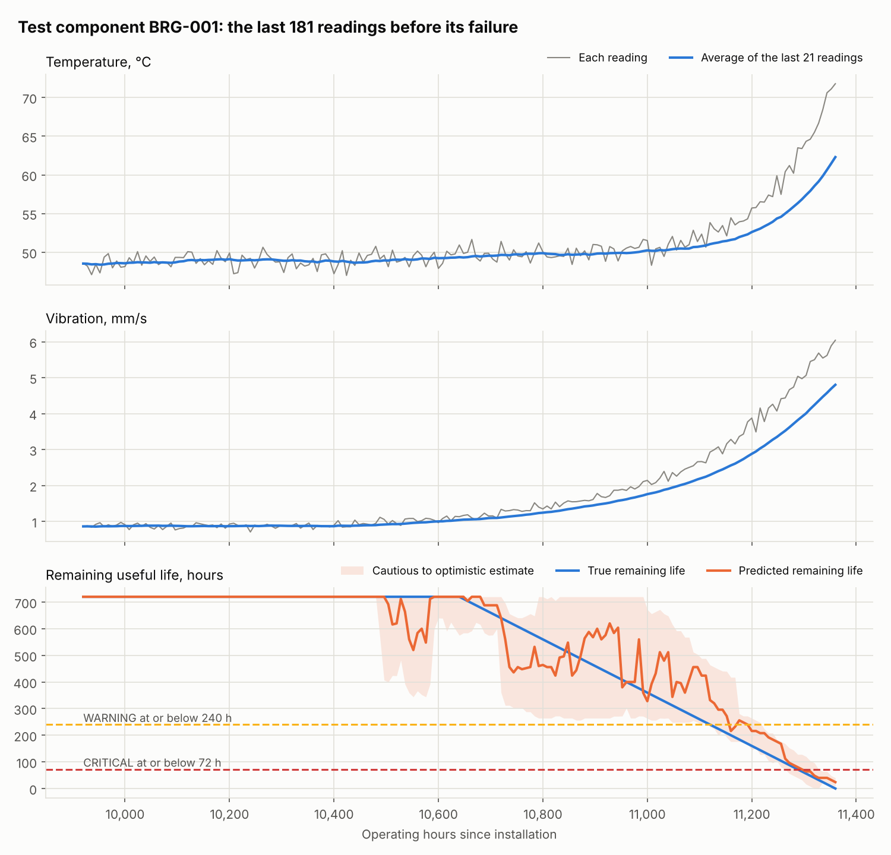

# Ring-frame component life predictor

Predicts the **Remaining Useful Life (RUL)** of a textile ring-frame component, such as a spindle bearing,
from its **temperature** and **vibration** readings, and turns the prediction into a preventive-maintenance
work list (`HEALTHY` / `WARNING` / `CRITICAL` plus the action to take).

> The CSV files in `data/` are **simulated**, so the program can be tried immediately. The accuracy figures
> below describe that simulation only. Train the program on your own failure records before relying on it.

## Quick start

```bash
pip install -r requirements.txt
python ring_frame_life_predictor.py          # uses the sample files in data/
```

With your own data:

```bash
python ring_frame_life_predictor.py --history my_failures.csv --current my_machine.csv --output results
```

`python generate_sample_data.py` recreates the sample files. Tested on Python 3.11 and 3.13.

## Files

| File | Purpose |
|---|---|
| `ring_frame_life_predictor.py` | The program: analysis, training, checking, prediction, report. **Every line has a comment that explains it.** |
| `generate_sample_data.py` | Creates the simulated sample data (also commented line by line). |
| `data/training_history.csv` | 60 simulated bearings logged from installation to failure. |
| `data/current_readings.csv` | 12 simulated bearings that are still running. |
| `data/current_answer_key.csv` | True remaining life of those 12, to check the predictions. Real data has no such file. |
| `output/maintenance_report.csv` | The work list produced by the program. |
| `output/example_component.png` | Chart of one test bearing: sensors and predicted life. |

## Input data

Both CSV files need these four columns (extra columns are ignored):

| Column | Meaning |
|---|---|
| `component_id` | Name or number of the component, e.g. `BRG-017` |
| `operating_hours` | Running hours of that component since it was installed |
| `temperature_c` | Temperature in °C |
| `vibration_mm_s` | Vibration velocity (RMS) in mm/s |

- `--history` holds components that **have failed**. Each log must end with the failure, because the last
  row of a component is taken as its moment of failure. Leave out components that were replaced while still
  working.
- `--current` holds components that are **still running**. Give at least the last 42 readings of each
  (two windows); the program prints a note for components with fewer.
- Readings must be logged at a regular interval. The sample uses one reading per 8-hour shift.

## The algorithm: Random Forest Regression

A random forest is a collection of decision trees that vote. This is how the program uses it:

1. **Features.** For every reading the last 21 readings of each sensor (7 days) are summarised by four
   numbers: the average (*level*), the standard deviation (*variability*), the maximum (*peak*) and the
   average now minus the average one window earlier (*trend*). Two sensors give eight inputs. The windows
   only look backwards and never mix two components.
2. **Target.** Every reading of a failed component is labelled with the life that was really left:
   hours at failure minus hours at the reading, capped at 720 h. The cap is needed because a healthy
   bearing looks the same with 1,000 or 10,000 hours left; its sensors cannot show the difference.
3. **Trees.** Each of the 200 trees receives its own random sample of the training readings. It splits
   them again and again with yes/no questions such as "is `vibration_mm_s_std` above 0.21?", each time
   choosing, among a random half of the eight inputs, the question that separates long from short remaining
   lives best. It stops when all readings in a group have the same remaining life. A new reading is passed
   down the tree and receives the remaining life of the group it lands in.
4. **Three estimates.** The 200 answers for one reading are sorted. The 10th percentile is the *cautious*
   estimate, the median is the *best* estimate and the 90th percentile is the *optimistic* estimate.
5. **Decision.** The status comes from the cautious estimate: at or below 72 h `CRITICAL`, at or below
   240 h `WARNING`, otherwise `HEALTHY`.
6. **Check.** A quarter of the failed components is held back and never shown to the model during
   training. Whole components are held back, not single rows, because neighbouring readings of one
   component are almost identical and would make the test far too easy.

Why this algorithm fits the task:

- The link between sensor behaviour and remaining life is not a straight line, and it differs between
  failures that show first as heat and failures that show first as vibration. Trees learn such patterns
  without a formula.
- It works with a few dozen failure histories. Neural networks such as LSTMs need far more.
- It needs no scaling of the inputs and is not thrown off by noisy readings.
- The disagreement between the trees gives the cautious estimate that maintenance decisions should use.
- It reports how much each measurement contributed, so the result can be explained on the shop floor.

## What the sample run shows

```text
STEP 3 - CHECK ON 15 COMPONENTS THE MODEL HAS NEVER SEEN
  Average error of the predicted life in the last 720 h before failure: 80 h
  Average error of the predicted life in the last 240 h before failure: 26 h
  True life inside the cautious-to-optimistic range: 70% of the readings in the last 720 h
  True life shorter than even the cautious estimate: 21% of the readings in the last 720 h
  Warning time before failure: shortest 248 h, median 280 h
  False alerts with more than 720 h left: 3 of 12,903 readings
  Number of test readings by true status (rows) and by the status the model gave (columns):
model said   HEALTHY  WARNING  CRITICAL
true status
HEALTHY        13610      178         0
WARNING            0      250        65
CRITICAL           0        0       150
```

- All 15 unseen bearings were flagged at least 248 h (about 10 days) before they failed.
- No reading from the last 72 h of life was called `HEALTHY`.
- The estimate is sharp close to the failure (26 h average error in the last 240 h) and rough further
  away (80 h in the last 720 h).
- The cautious estimate is not a guarantee: the true life was shorter still for 21 % of the wear-out
  readings.

Predictions for the 12 running bearings next to the answer key (hours):

| Component | True life left | Predicted | Cautious | Optimistic | Status |
|---|---|---|---|---|---|
| BRG-109 | 32 | 16 | 0 | 41 | CRITICAL |
| BRG-102 | 24 | 32 | 0 | 56 | CRITICAL |
| BRG-112 | 72 | 80 | 47 | 112 | CRITICAL |
| BRG-105 | 48 | 56 | 48 | 88 | CRITICAL |
| BRG-111 | 112 | 112 | 96 | 144 | WARNING |
| BRG-106 | 168 | 184 | 136 | 248 | WARNING |
| BRG-103 | 576 | 380 | 360 | 600 | HEALTHY |
| BRG-101 | 248 | 504 | 360 | 624 | HEALTHY |
| BRG-107 | 376 | 720 | 472 | 720 | HEALTHY |
| BRG-108 | 1,320 | 720 | 711 | 720 | HEALTHY |
| BRG-104 | 2,000 | 720 | 720 | 720 | HEALTHY |
| BRG-110 | 872 | 720 | 720 | 720 | HEALTHY |

All 12 statuses match what the true remaining life calls for, and the six urgent bearings are predicted
to within 16 h. The three bearings in the middle (BRG-101, BRG-103, BRG-107) are off by 196 to 344 h:
their wear is only just becoming visible. A predicted life of 720 h means "no wear visible yet: 720 h or
more". Run the program every shift or every day, so that each bearing is re-assessed as its wear develops.



## Adapting it to your mill

The settings are at the top of `ring_frame_life_predictor.py`:

| Setting | Default | Set it to |
|---|---|---|
| `SENSORS` | temperature, vibration | Your column names. Add a line for another sensor, e.g. spindle speed or room temperature. |
| `WINDOW` | 21 readings | About one week of readings at your logging interval. |
| `RUL_CAP` | 720 h | How long before a failure wear first becomes visible in your data. |
| `WARNING_HOURS` | 240 h | At least the time you need to get a spare and plan the stop. |
| `CRITICAL_HOURS` | 72 h | The remaining life at which you want the part replaced at once. |
| `HOURS_PER_DAY` | 24 | Running hours per calendar day in your mill. |

## Limitations

- The model can only learn from failures it has seen. It needs complete failure histories; with fewer
  than about 20 treat the results as indicative. Step 3 of the output shows the accuracy on your own data.
- Train one model per component type. Large changes in spindle speed, yarn count or room temperature
  shift the readings; if you log them, add them to `SENSORS`.
- A failure that gives no warning in temperature or vibration cannot be predicted.
